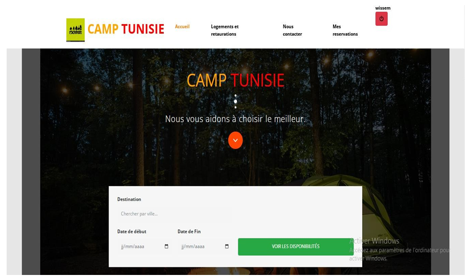
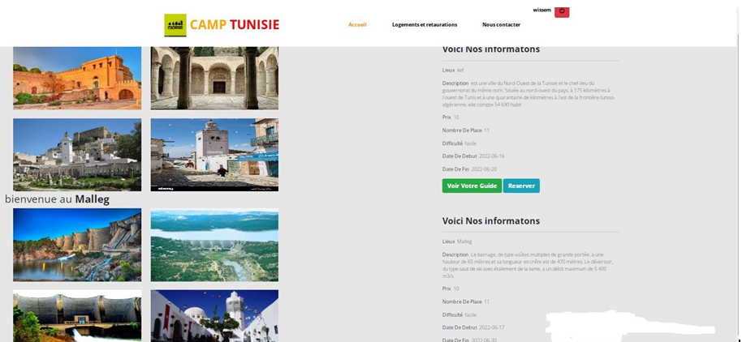
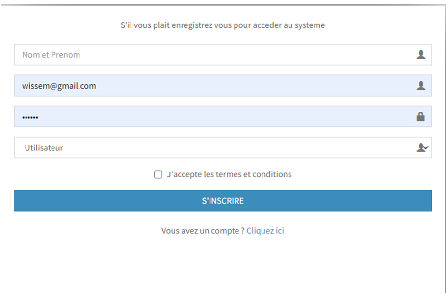
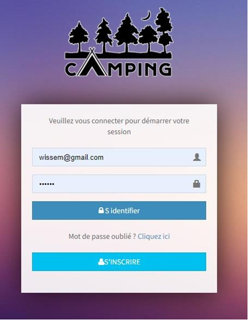
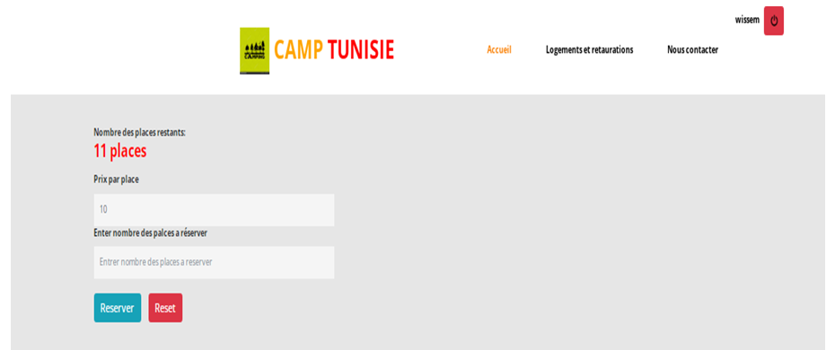
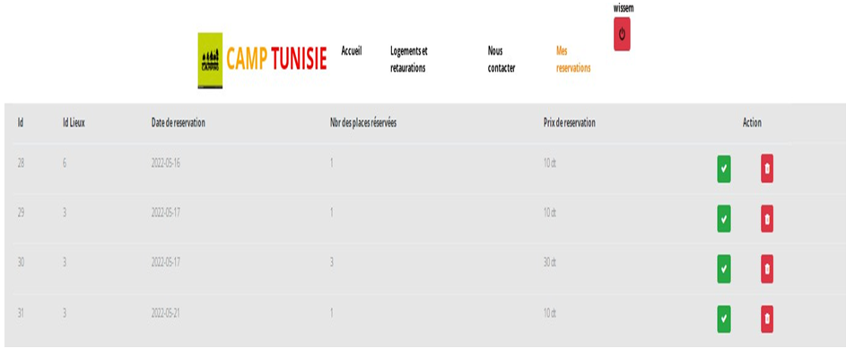
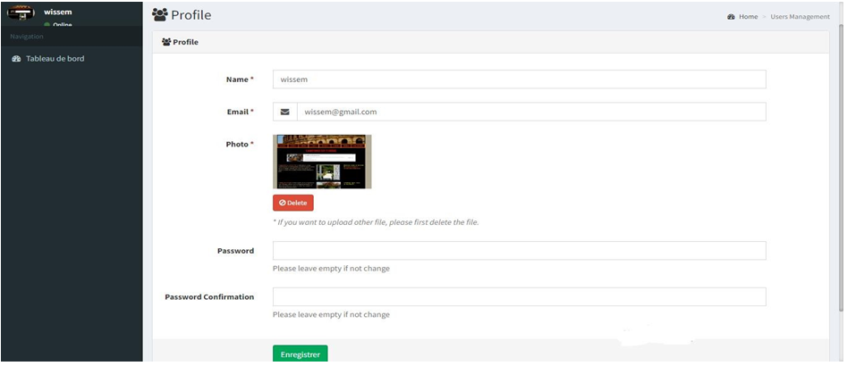

# 💻 Gestion de camping — Application web Laravel

Application web de gestion et de consultation des ressources liées à un camping, développée avec **PHP et Laravel 5.7**. Le projet couvre notamment les lieux, services, guides, visiteurs et réservations.

> **Contexte :** projet réalisé dans le cadre de mon stage de fin d’études chez **Sprint Code** (2022).
>
> **Résumé pour recruteurs :** expérience pratique en développement web avec Laravel, gestion des données MySQL/MariaDB et réalisation de fonctionnalités applicatives. L’état actuel du dépôt et les limites de compatibilité sont précisés ci-dessous.

> **État du projet :** le dépôt repose sur une version ancienne de Laravel (5.7). Avant toute utilisation, vérifiez les fichiers indispensables, les dépendances et la compatibilité de l’environnement. Dans l’archive analysée, les fichiers `artisan` et `.env.example` étaient absents ; confirmez leur présence dans votre copie locale.

## ✨ Fonctionnalités repérées

- Page d’accueil présentant les données liées aux lieux, services, visiteurs, guides et réservations.
- Pages de consultation des lieux et des services.
- Pages de présentation et de détail des guides.
- Consultation d’une réservation par identifiant.
- Pages relatives aux visiteurs et aux réservations personnelles.
- Interface d’administration basée sur Laravel CRUDbooster.
- Ressources de données pour les villes, lieux, services, guides, visiteurs et réservations.

Cette liste s’appuie sur les routes, contrôleurs, vues et migrations du projet. Le parcours complet de réservation, les règles de disponibilité, le paiement et les autorisations doivent être validés en exécutant l’application.

## 🛠️ Technologies

- **Backend :** PHP, Laravel 5.7
- **Administration :** Laravel CRUDbooster 5.4
- **Base de données :** MySQL / MariaDB, selon la configuration
- **Frontend :** Blade, Bootstrap 4, JavaScript, Sass, Laravel Mix
- **Tests :** PHPUnit

## 🗂️ Structure du projet

```text
Gestion-Camping-/
├── app/Http/Controllers/   # Contrôleurs web et administration
├── config/                # Configuration Laravel
├── database/
│   ├── migrations/        # Schéma de données
│   ├── factories/
│   └── seeds/             # Données de démonstration éventuelles
├── public/                # Point d’entrée et ressources publiques
├── resources/
│   ├── lang/              # Traductions
│   ├── sass/              # Styles Sass
│   └── views/             # Vues Blade
├── routes/
│   ├── web.php            # Routes web
│   └── api.php             # Route API d’exemple
├── tests/                 # Tests PHPUnit
├── composer.json
├── composer.lock
└── package.json
```

## ⚙️ Prérequis

- Version de PHP compatible avec Laravel 5.7 et les dépendances verrouillées.
- Composer.
- MySQL ou MariaDB.
- Node.js et npm uniquement si les ressources frontend doivent être recompilées.
- Git.

Laravel 5.7 n’est plus une version maintenue. Une mise à niveau et un audit des dépendances sont recommandés avant toute exposition publique.

## ⚙️ Installation locale

### ⚙️ 1. Cloner le dépôt

```bash
git clone https://github.com/WissemAttouf/Gestion-Camping-.git
cd Gestion-Camping-
```

### ➡️ 2. Vérifier les fichiers requis

Une application Laravel contient normalement le fichier `artisan` et un modèle `.env.example`. S’ils sont absents, restaurez-les depuis une copie complète du projet avant de poursuivre.

### ➡️ 3. Installer les dépendances

```bash
composer install
```

Si Composer signale une incompatibilité, vérifiez la version de PHP et les extensions requises plutôt que de contourner durablement les contrôles de plateforme.

### ➡️ 4. Configurer la base de données

Créez une base, par exemple `gestion_camping`, puis configurez les paramètres locaux dans `.env` lorsque ce fichier est disponible :

```dotenv
APP_NAME="Gestion de camping"
APP_ENV=local
APP_DEBUG=true
APP_URL=http://127.0.0.1:8000

DB_CONNECTION=mysql
DB_HOST=127.0.0.1
DB_PORT=3306
DB_DATABASE=gestion_camping
DB_USERNAME=root
DB_PASSWORD=
```

Adaptez les valeurs à votre environnement. **Ne publiez jamais de fichier `.env` ni d’identifiants réels.**

### ⚙️ 5. Lancer l’application

Lorsque les fichiers requis et les dépendances sont en place, utilisez la commande Laravel adaptée à cette version et à l’environnement PHP installé. Vérifiez les migrations et les instructions propres au dépôt avant de lancer l’application.


## 📸 Captures d’écran

<p align="center">
  
  <br><strong>Accueil</strong>
  <br><em>Page d’accueil de l’application Gestion Camping.</em>
</p>

<p align="center">
  
  <br><strong>Détails</strong>
  <br><em>Vue détaillée d’un élément lié au camping.</em>
</p>

<p align="center">
  
  <br><strong>Inscription — aperçu 1</strong>
  <br><em>Premier aperçu du parcours d’inscription.</em>
</p>

<p align="center">
  
  <br><strong>Inscription — aperçu 2</strong>
  <br><em>Vue complémentaire du formulaire d’inscription.</em>
</p>

<p align="center">
  
  <br><strong>Réservations — aperçu 1</strong>
  <br><em>Premier aperçu de l’interface de réservation.</em>
</p>

<p align="center">
  
  <br><strong>Réservations — aperçu 2</strong>
  <br><em>Vue complémentaire des réservations.</em>
</p>

<p align="center">
  
  <br><strong>Profil utilisateur</strong>
  <br><em>Page consacrée au profil utilisateur.</em>
</p>

---

## 👨‍💻 Auteur

**Wissem Attouf** — Ingénieur logiciel | Développeur Full Stack  
Projet réalisé dans le cadre de mon parcours en développement web.

[GitHub](https://github.com/WissemAttouf) · [LinkedIn](https://www.linkedin.com/in/wissem-attouf-452509226/) · [Portfolio](https://wissem-portfolio.vercel.app/) · [E-mail](mailto:wattouf35@gmail.com)

---
